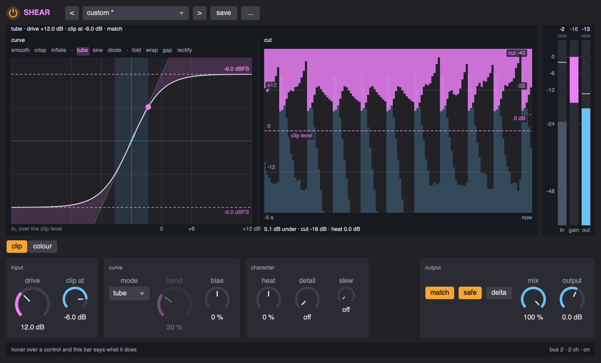
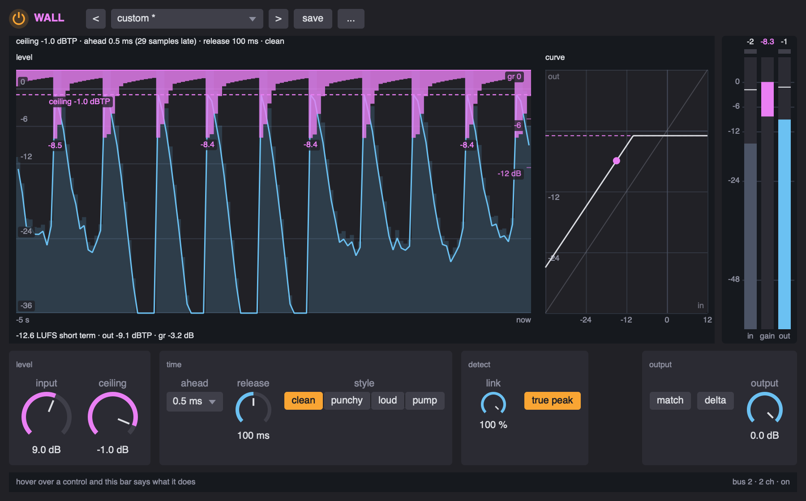

# Peaks

**Two ways to keep peaks under a level: Shear, a clipper with ten curves that is antialiased and matched to its input's loudness, and Wall, a lookahead limiter that catches the peaks between samples. Both run anywhere a UGen does, and both have a window.** A SuperCollider extension.



```supercollider
s.boot;
Ndef(\bass, { Shear.ar(Saw.ar([55, 55.3]) * 0.5, \shear) }).play;

c = Shear(Ndef(\bass), \shear);
c.gui;
c.drive = 18; c.mode = \tube;        // harder into a warmer curve, at the same loudness
c.mode = \fold; c.bend = 0.45; c.tone = 4500;
c.preset = 'germanium fuzz';
```

```supercollider
Ndef(\mix, { Wall.ar(SinOsc.ar([110, 111]) * LFPulse.kr(2).range(0.2, 1.5), \wall) }).play;

w = Wall(Ndef(\mix), \wall);
w.gui;
w.input = 6; w.limit = -1;           // 6 dB louder, nothing over -1 dBTP
w.style = \punchy;
```



Each effect of this family runs in the same three places. You can write `Shear.ar` or `Wall.ar` into a graph of your own and drive it from the object, as above. You can give it a node of its own on a bus, `Wall.onBus(0, 2).enabled_(true)`. Or you can put it in a chain, `FxChain.master.add(Wall())`. If SuperDirtGUI is installed, both are also inserts on an orbit, a return or the master: `~sdg.addInsert(0, \shear)`, `~sdg.addInsert(0, \wall)`. They are listed under *dynamics*, next to the compressor.

Shear takes its modes from the clippers people already use: StandardCLIP and KClip for the clean ones, the Oxford Inflator, Airwindows' Density, a germanium fuzz, the Buchla 259 wavefolder, and a broken converter. Wall works like FabFilter Pro-L and Ableton's Limiter: a hold and a box that look ahead, a release in two stages, and BS.1770's true-peak detector. The DSP and the windows are this family's own.

Both are built on [FxKit](https://github.com/fracnesco/sc-fx-kit), and the class library will not compile without it; the installer links it when the folders sit side by side. Peaks uses SuperCollider's own UGens, not sc3-plugins.

Written for SuperCollider 3.13 on macOS. Nothing in it is platform specific apart from the symlink in `install.scd`, which works on Linux but not on Windows.

## Install

### As a quark

```supercollider
Quarks.install("https://github.com/fracnesco/sc-peaks.git");
thisProcess.recompile;
```

The manifest names `sc-fx-kit` as a dependency, so `Quarks` fetches that first. The quark goes by the name of the repository, `sc-peaks`. The classes inside it are `Shear`, `Wall` and `PeakKit`.

### From a clone

Clone `sc-fx-kit` into a folder called `sc fx kit` and this repository into `sc peaks`, side by side. Open `install.scd`, evaluate its first block, then recompile the class library. It links whatever is missing and tells you what it did.

On Windows there is no `ln -s`. Use the quark there, or copy the three folders into the extensions folder by hand: `Platform.userExtensionDir.openOS` opens it.

Install it one way or the other, **not both**. Two copies on the class path cause a duplicate class error at compile time.

### Check that it took

```supercollider
Shear.presetNames;
Wall.presetNames;
Wall.onBus(0, 2).enabled_(true).gui;
```

Select `Shear` or `Wall` and press cmd/ctrl + d to open its help file. [examples/peaks-demo.scd](examples/peaks-demo.scd) is a walkthrough you can evaluate one block at a time.

## Shear: what it does

A clipper flattens whatever goes past a level. Shear lets you set that level and how the corner is shaped:

- `clip` is the level, in dB.
- `drive` is how far past the level the sound is pushed.
- `mode` is the shape of the curve.
- `bend` is each curve's own character.

Two switches stay on unless you turn them off:

- **`match`** keeps the output at the input's loudness. The drive is taken back at once, and what the curve takes away is given back from a measured table: by mode and bend, by how far over the clip level the sound goes, and by how peaky it is. So the drive changes the character and not the loudness, and a drive step from a pattern stays level. It never turns the sound up past the input: a sound already far over the clip level at drive 0 comes out quieter, held at the clip level.
- **`safe`** clips whatever is left at the clip level, after everything else. With it on, nothing leaves Shear above `clip`. That is the one thing a clipper has to get right.

| mode | family | what it is | bend |
|---|---|---|---|
| `smooth` | clean | a straight line up to a knee, then flat. At bend 0 it is a hard clip. The mastering clipper | the width of the knee |
| `crisp` | clean | a line, then 2:1 in dB, then a wall: a converter's "digital saturation", with an edge | where the 2:1 starts, from -1 to -12 dB |
| `inflate` | clean | the Oxford Inflator's polynomial: louder quiet parts, few harmonics | its curve, from -50 to +50 |
| `tube` | colour | tanh. With `bias`, an asymmetric triode | not used (dimmed) |
| `sine` | colour | rounder than tanh (Airwindows' Density), flat from +3.9 dB over the level | not used (dimmed) |
| `diode` | colour | soft on the top half, earlier and harder on the bottom: fuzz, even harmonics | how much the halves differ |
| `fold` | creative | the Buchla 259 timbre circuit: bright, vocal, moves with the level | the folding depth (about 20 dB of level) |
| `wrap` | creative | past the level the wave jumps to the other side (a broken converter), or folds back | wrap at 0, fold at 1 |
| `gap` | creative | quiet detail drops out, tails sputter: the inverse of clipping, then a clip | how wide the gap is |
| `rectify` | creative | the bottom half turned up: the octave above, hollow | half wave at 0.5, full wave at 1 |

**Around the curve.** `bias` moves the signal along the curve, which makes it asymmetric and adds even harmonics. `skew` gives the two sides different biases: left and right in `lr`, the middle and the sides in `ms`. That makes width out of distortion. `heat` makes the drive follow the level: at + loud passages are driven harder, at - the quiet ones are. `detail` gives back the highs of what was cut and leaves the lows clipped. `slew` dulls the loudest fast edges. `thump` puts a low shelf before the curve and its mirror after it, so the lows hit the curve harder (+) or are spared (-). `tone` is a low pass over the result. `delta` plays only what the clipper takes away.

**Antialiasing, and why it is one sample late.** A clipper makes harmonics above Nyquist that fold back down as noise. Shear uses first-order ADAA (antiderivative antialiasing) in Vicanek's transparent form: a one-pole before the curve, the curve's antiderivative, a one-pole after. Wherever the curve is a straight line, the three together are a first-order allpass. Below the clip level the sound passes untouched except for that allpass, which is about one sample late (0.71 samples at low frequencies, 1.41 at the top). The dry signal goes through the same allpass, so `mix` and bypass never comb. On an orbit, Shear keeps the orbit in time.

The allpass is -1 at Nyquist. Don't put Shear on a return that is a parallel copy of its orbits: summed with the dry orbit, the very top cancels a little. Put it on the orbit itself instead. On a return that plays the wet sound alone, such as a reverb's, nothing cancels.

**Measured offline** (an NRT render per case, read back, 48 kHz):

- **Below the clip level:** the output is the allpassed input to 5.5e-6, flat within 0.0001 dB from 20 Hz to 20 kHz.
- **With `safe` on:** the output never went over the clip level, in every mode with every modifier on at once. The worst excess was 9e-8.
- **With `safe` off:** a driven bass can go up to +2.6 dB over for a few hundred ms as it starts (+3.7 dB in wrap). That is the DC filter settling. Steady sounds stay within +2.6 dB.
- **Antialiasing:** smooth at 2.5 and 5 kHz is 4.0-5.2 dB cleaner than the same curve without antialiasing, and tube is 3.5-4.7 dB cleaner. Plain first-order ADAA would give about 7 dB. The transparent form gives up about 3 dB of that to stay flat in the passband.
- **`match`:** pink noise and a drum loop at -18 dBFS RMS, clip -6, drive 0 to 36, every mode at bend 0, 0.5 and 1: the mean of the two within 1 dB of the input wherever match makes up (smooth, crisp, tube and sine within 0.5 dB), each source within 3.4 dB (rectify at full bend on the drums). A -30 dBFS tone that never reaches the curve comes out at its own level at any drive. Where the clip level sits under the input's own loudness (clip -18 here, or drive 0 into a low clip), match stops at 0 dB and the output is that much quieter: 1.7 to 9 dB here. A drive step from a pattern (0 to 24 or 36 and back, on a tone and on pink) stays level within 1.1 dB in the clean and colour modes, 3.1 dB in the creative ones; drive and clip glide over about 80 ms. Switching mode moves the settled level by under 1 dB (it was up to 8). The presets lie within 5.3 dB of each other on pink noise (west coast fold is the quietest: its 4.5 kHz tone is part of the sound).
- **`bias` and `thump` are not matched:** at drive 12, bias 0.25 makes the modes 1-3 dB quieter and 0.5 about 1.5-4 dB quieter; thump +12 on a sub loses a few dB more. The two presets that use them carry their own output trim (tube bus +1.6 dB, shatter sub +4.6 dB, measured).
- **`heat`:** at -, a passage more than 6 dB under the clip level is driven harder. Steady loud parts clip less. Keep `safe` on with it.

## Wall: what it does

A limiter turns the sound down just enough that nothing passes a level. The ceiling is `limit`, in dBTP while `truePeak` is on (the default) and in dBFS otherwise. `input` pushes the sound into the ceiling, so it gets louder until it is squashed. Two things set Wall apart from SuperCollider's `Limiter.ar`:

- **It looks ahead** (`ahead`) and starts turning down before a peak arrives, instead of clipping the peak. A hold followed by a box (Signalsmith's and Rudrich's design) proves that no sample gets over the ceiling.
- **It watches the true peak**, the peaks between the samples that a converter or an mp3 encoder makes. It uses BS.1770's four-phase detector plus three more interpolated points (see `PeakKit`).

**Styles.**

- `clean` releases in two stages: a fast one for transients, and a slow one that keeps a bass steady.
- `punchy` uses the fast stage alone. It is snappier, and it pumps when pushed.
- `loud` soft-clips first, at the ceiling + 2 dB, with Shear's antialiased smooth curve, and the limiter takes the rest.
- `pump` releases linearly in dB, so it breathes on purpose.

`recovery` is the release time constant. In pump it is the time to come back 6 dB.

**Looking ahead makes the sound late,** by (w - 1) + 6 samples, where w is the window in samples. `loud` adds one sample for its allpass.

| ahead | 44.1 kHz | 48 kHz | 96 kHz |
|---|---|---|---|
| none | 6 | 6 | 6 |
| 0.5 ms (default) | 27 | 29 | 53 |
| 1.5 ms | 71 | 77 | 149 |
| 3 ms | 137 | 149 | 293 |
| 6 ms | 270 | 293 | 581 |

Measured to the sample, and in a live SuperDirt: an orbit with Wall was 29 samples behind an orbit without it. The window's caption shows the latency. **SuperDirt has no delay compensation.** Wall on one orbit puts that orbit late against the others. With 6 ms on a drum orbit you hear a flam, and the same kick on two orbits combs. Keep the default 0.5 ms on an orbit. On a return, use Wall only when the return plays the wet sound alone, never on one that is a parallel copy of its orbits. On the master, 3-6 ms keeps the mix's timing only when no orbit is routed `\direct`. For comparison, SuperDirt's own limiter on every orbit (`limitertype` 1, the default) is 20 ms late against `limitertype` raw: 960 samples, measured.

`none` is 6 samples late, but it is a clipper with a release, not a limiter. A 70 Hz sine 6 dB over comes out with -38 dB of distortion, where 6 ms gives -109 dB.

**No `mix`, and `output` only turns down.** A limiter blended with its dry signal lets the dry's peaks through. So Wall has no mix, and the ceiling is the unit's last word. Anything after it, such as a strip's fader above 0 dB, is not held by it. `delta` plays only what the limiter takes away. `match` turns the output down by the input gain, so you hear the limiting and not the loudness.

**Phase.** clean, punchy and pump are a pure delay: they null against the delayed input. loud adds the antialiasing allpass, so a null test shows a tilt of 0.7-1.4 samples in loud only.

**Measured offline** (48 kHz unless said):

- **The ceiling:** with an 8 kHz tone at -15 dBFS and a 0 dBFS click into limit -10, every style and every ahead gave -10.0000 dB, at 48 and at 96 kHz.
- **True peak on:** sines from 1 to 19 kHz, 6 dB over limit -1, came out at -0.93 dBTP at worst. With true peak off, the same sines reached +1.6 dBTP at 12 kHz.
- **Release:** after a 10 ms burst 6 dB over, clean at recovery 0.03 was back in 46 ms. punchy at 0.5 took 762 ms.
- **`limit` and `input` from a pattern:** the ceiling moves with the sound it applies to, so a step (`# limit "<-1 -6>"`) is never met by the last clip; after a step down, for the latency the output may still sit at the old ceiling. With `match` on, an `input` step leaves the level where it was. Measured with steps -1, -6, -1, -12, -3, -1 dB at +6 dB in, every style and ahead: the last clip acted by float rounding only (2e-5). Clipping at the ceiling of the moment instead, as Wall first did, cut up to 2 dB into the sound after a step down.
- **Switching `ahead` while sound plays clicks:** a jump of up to about 17 % of the amplitude, settled within 192 samples. Choose it before you play.
- **Readouts:** the gain-reduction readout equals the measured gain. The short-term loudness reads 0.1 LU under a BS.1770 reference.
- **Long runs:** after 10 minutes of drums limited by up to 14 dB, the gain was back to 1 within 6e-8.

## The windows

`c.gui` or `w.gui` opens one, and `c.panel(view)` puts the same thing in a view of yours. The top row has on, the presets, save, and a menu with copy and paste. Below it are the display, with the in, gain and out meters beside it, and the cards. Hover over anything and the bar at the bottom says what it does.

Everything drawn from the settings is a **model**: the curves, the ceiling line. Everything else is **measured** on the server and moves only while the window is open and sound passes: the dots, the shaded reach, the histories, the gain reduction, the readouts.

**Shear's display.** Left is "curve": the transfer curve of the current mode, bend, bias and skew, with the input along the bottom in units of the clip level. The dashed orchid lines are the clip level, labelled in dBFS. The orchid area between the curve and the diagonal is what gets cut. With skew, the second side's curve is dashed. The shaded band is how far the input reaches past the clip level, the small dots are where the sound sat on the curve, and the big dot is the loudest point since the last reply. Right is "cut": five seconds of how far the input went past the clip level (blue, from below) and how loud the part that was cut was, against the input (orchid, hanging from the top, -40 to 0 dB). The meter's gain bar shows how much the curve turned the loudest peak down.

| in Shear's display | does |
|---|---|
| click a mode word | that mode |
| drag the curve up and down | drive |
| drag a dashed clip line | the clip level |
| the wheel on the curve | bend |
| alt + the wheel | bias |
| shift | fine, a tenth as far |
| double click | back to the default of what is under it; on the history, clear it |

**Wall's display.** Left is "level": five seconds of the input peak plus `input` (faint, from below), the output peak (a line), and the gain reduction hanging from the top on its own scale (0 to -12 dB, with the deepest written once a second). The dashed line is the ceiling, `limit + output`. Right is "curve": the static curve, flat at the ceiling (with loud's soft knee), and the input riding it as a dot. The readout line under it gives the short-term loudness, the output's true peak and the gain reduction. The meter's gain bar is the deepest gain reduction of the last replies.

| in Wall's display | does |
|---|---|
| drag the dashed ceiling | limit (the line follows the pointer) |
| drag anywhere else | input |
| the wheel | recovery |
| shift | fine, a tenth as far |
| double click | back to the default of what is under it; outside both, clear the history |

## Presets

- **Shear:** default, standard clip, crisp converter, inflator, tube bus, density, germanium fuzz, west coast fold, digital over, sputter, octave peaks, shatter sub.
- **Wall:** default, modern, master safe, live limiter, punchy drums, loud, bus pump, l2 classic, orbit guard, what it takes. `what it takes` plays delta at input +9: what a hard limiter would take out of the sound.

Your own presets go in `Platform.userAppSupportDir/shear-presets.scd` and `wall-presets.scd`. Save one with `c.saveAsPreset("mine")`, or press save in the window and give it a name. `c.copySettings` and `other.pasteSettings` carry settings from one object to another.

## Parameters

Every parameter is a property: `c.drive`, `c.drive = ...`. These also work by name: `c.set(\drive, ...)`, `c.get(\drive)`. Knobs clip to their range. The *label* is what the window shows. The *parameter* is the name in code and the word in Tidal, and the two differ where the label's word is taken in Tidal or Haskell: `ceiling` is a Prelude function, so Wall's ceiling is `limit`. These tables are generated from the classes.

### Shear

| parameter | label | section | range | default | Tidal | what it does |
|---|---|---|---|---|---|---|
| `drive` | drive | input | 0 .. 36 dB | 6 | yes | how far past the clip level the signal is pushed - or drag the curve |
| `clip` | clip at | input | -36 .. 0 dB | -6 | yes | the level the curve flattens at: nothing passes it (with safe on) |
| `mode` | mode | curve | smooth crisp inflate tube sine diode fold wrap gap rectify | smooth | yes | the curve: clean (smooth crisp inflate), colour (tube sine diode), creative (fold wrap gap rectify) |
| `bend` | bend | curve | 0 .. 1 | 0.3 | yes | the curve's own character: smooth knee, crisp's start, inflate's curve, diode's lean, fold's depth, wrap to fold, gap's width, half to full rectify |
| `bias` | bias | curve | -1 .. 1 | 0 | yes | shifts the signal along the curve: asymmetry, even harmonics |
| `heat` | heat | character | -1 .. 1 | 0 | yes | +: loud passages are driven harder and their clipped peaks squashed; -: passages well under the clip level are driven harder and loud steady ones clip less (needs safe to keep the ceiling) |
| `slew` | slew | character | 0 .. 1 | 0 | yes | dulls the loudest fast edges, as a tired op-amp would |
| `detail` | detail | character | 0 .. 1 | 0 | yes | gives back the highs of what was cut: the lows stay clipped |
| `tone` | tone | tone | 1000 .. 20000 Hz | 20000 | yes | a low pass over the clipped sound - 20 kHz is off |
| `thump` | thump | lows | -12 .. 12 dB | 0 | yes | +: the lows hit the curve harder and come out thinner; -: they are spared the colour, and safe clips them if they pass the clip level |
| `thumpFreq` | low freq | lows | 40 .. 800 Hz | 120 | yes | where thump's shelf turns |
| `stereo` | stereo | stereo | lr ms | lr | - | lr: each channel clipped alone; ms: the middle and the sides |
| `skew` | skew | stereo | 0 .. 1 | 0 | yes | a different bias on each side (or on middle and sides): width from distortion |
| `match` | match | output | on off | on | - | the output kept at the input's loudness: the drive taken back and what the curve takes away given back, never louder than what comes in |
| `safe` | safe | output | on off | on | - | a wall at the clip level after everything, so nothing passes it |
| `delta` | delta | output | on off | off | - | hear only what the clipper takes away (at mix 100) |
| `mix` | mix | output | 0 .. 1 | 1 | yes | how much of the effect goes out, against the dry signal |
| `output` | output | output | -36 .. 24 dB | 0 | - | the level of the whole thing, in dB |

### Wall

| parameter | label | section | range | default | Tidal | what it does |
|---|---|---|---|---|---|---|
| `input` | input | level | -12 .. 24 dB | 0 | yes | how hard the signal is pushed into the ceiling - or drag the history up |
| `limit` | ceiling | level | -12 .. 0 dB | -1 | yes | nothing goes over this: in true peak (dBTP) when true peak is on |
| `ahead` | ahead | time | none, 0.5 ms, 1.5 ms, 3 ms, 6 ms | 0.5 ms | - | how far ahead it looks: longer is cleaner but puts this track that much late, and combs with the same sound on another orbit. none = a clipper with a release (6 samples late) |
| `recovery` | release | time | 0.005 .. 2 s | 0.1 | yes | how quickly the level comes back after a peak (a time constant; in pump, the time to come back 6 dB) |
| `style` | style | time | clean punchy loud pump | clean | - | clean: steady on bass; punchy: snappier, pumps when pushed; loud: a clipper first; pump: breathes on purpose |
| `link` | link | detect | 0 .. 1 | 1 | yes | 100: every channel turned down together, the image stays; 0: each alone |
| `truePeak` | true peak | detect | on off | on | - | catch the peaks between samples, as a converter or an mp3 makes them |
| `match` | match | output | on off | off | - | the output turned down by the input gain: hear the limiting, not the loudness |
| `delta` | delta | output | on off | off | - | hear only what the limiter takes away |
| `output` | output | output | -24 .. 0 dB | 0 | - | the level after the limiter, only down: the ceiling stays the last word |

Both work on any number of channels. Shear clips channels in pairs (lr or ms) and an odd last channel alone. Wall links every channel: with `link` at 100 % the loudest channel sets the gain for all of them.

## In SuperDirtGUI and Tidal

On an insert's right-click menu, **listen to tidal** gives the insert a name (`shear`, `wall`). A pattern then plays it by its parameters, one event at a time:

```haskell
d2 $ s "shear*4" # mode "<smooth fold wrap>" # drive "0 18" # bend 0.4
d3 $ s "wall" # limit (-3) # recovery 0.05
d1 $ s "bd*4" # fx "shear" (drive 12)
```

The Tidal column above says which parameters a pattern can move. The menus that switch the curve (`mode`) can, but `stereo`, `style`, `ahead` and the switches cannot: they click or change the latency. If your boot file does not know a word yet, define it the way the others are (`let bend = pF "bend"`, `mode = pS "mode"`).

Some words are shared with other effects of the family, with the same meaning but not the same range. `drive` means "how hard" everywhere, but Shear's runs from 0 to 36 dB, Spiral's from 0 to 24 dB and Coil's from 0 to 1. A pattern written for one effect's drive does not carry over to another at the same numbers. `input`, `tone` and `mix` are shared the same way. Wall has no `mix`.

## Cost

A stereo Shear is 1575 UGens, and a stereo Wall 1002. Both load on a stock server (64 wire buffers) at 1, 2 and 4 channels. Measured in real time at 48 kHz, as net CPU:

- **Shear:** 6.9 % stereo, about 1.06 times a stereo Imager in the same run.
- **Wall:** 3.9 % stereo, about 0.70 times a stereo Imager.

## Files

| file | what it is |
|---|---|
| [classes/PeakKit.sc](classes/PeakKit.sc) | what Shear and Wall share: the ten curves and their antiderivatives, the antialiasing, an exact delay, the true peak, the window max, short-term loudness |
| [classes/Shear.sc](classes/Shear.sc) | the clipper: parameters, presets, DSP, the curve the window draws |
| [classes/ShearView.sc](classes/ShearView.sc) | Shear's display: the curve and the cut history |
| [classes/Wall.sc](classes/Wall.sc) | the limiter: parameters, presets, DSP, latency and curve |
| [classes/WallView.sc](classes/WallView.sc) | Wall's display: the level history and the curve |
| [HelpSource/Classes/](HelpSource/Classes/) | a help file per class |
| [examples/peaks-demo.scd](examples/peaks-demo.scd) | a walkthrough, one block at a time |
| [install.scd](install.scd) | the symlink, a check, an uninstall |
| [sc-peaks.quark](sc-peaks.quark) | the quark manifest |
| [images/](images/) | the screenshots in this README |

## License

MIT - see [LICENSE](LICENSE).
